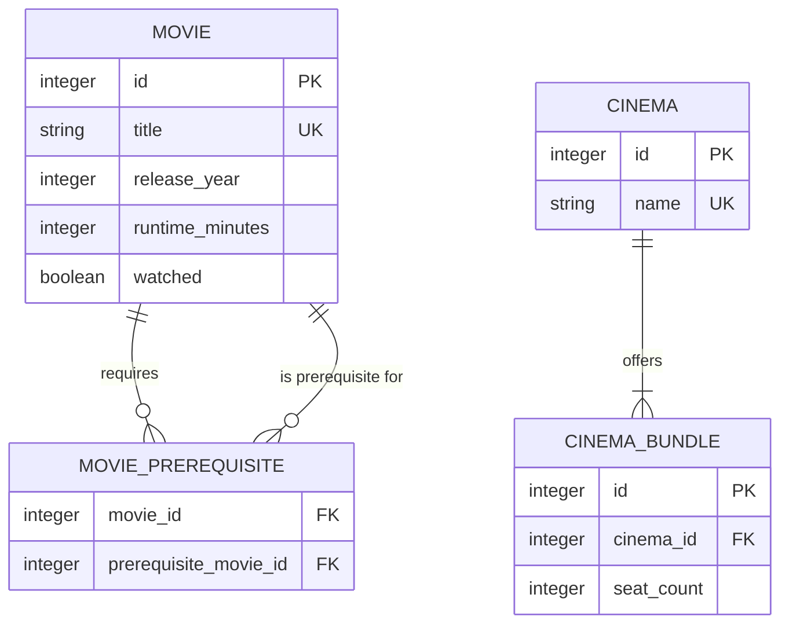

````markdown
# Doomsday Ready

Doomsday Ready is a full-stack app for MCU fans preparing for _Avengers: Doomsday_. It helps users plan the movies they need to rewatch and calculate opening-night cinema seat bundles for a group.

## Features

- Create, list, and update movies, including prerequisites and watched status.
- Show the prerequisite movies for a selected target in watch order, with watched progress and remaining runtime.
- Create cinemas with their available seat bundle sizes through the API.
- Calculate the fewest bundles that exactly fit a group, or report when an exact booking is not possible.
- Use the React interface to manage movies, view rewatch plans, and request booking quotes.
- Reject circular movie prerequisites with HTTP `409` and error code `CIRCULAR_DEPENDENCY`.

## Deployment

- Frontend: https://doomsday-ready-web.onrender.com/
- API base URL: https://doomsday-ready-api-nk4a.onrender.com/api
- API health check: https://doomsday-ready-api-nk4a.onrender.com/api/health

The deployed database starts with sample movie names. Add movies through the Movies screen. Cinemas can be created through the API.

## Technology

- Frontend: React and JavaScript
- Backend: Node.js, Express, and JavaScript
- Database: PostgreSQL
- Local database and API: Docker Compose
- Hosting: Render

## Project structure

```text
apps/
  api/
    migrations/
    src/
  web/
docker-compose.yml
README.md
```
````

## Data model



## Getting started

### Run the API and PostgreSQL with Docker

From the project root:

```powershell
docker compose up --build
```

This starts PostgreSQL and the API. The schema migration runs automatically when Docker initializes a new database volume.

The API is available at `http://localhost:3000`. Check it at `http://localhost:3000/api/health`.

To stop the containers, press `Ctrl+C`. To start them in the background, use:

```powershell
docker compose up -d
```

### Run the frontend

Open a second terminal:

```powershell
cd apps/web
npm install
npm run dev
```

Open the local URL printed by Vite, usually `http://localhost:5173`.

### Check the frontend

From `apps/web`, run:

```powershell
npm run lint
npm run build
```

## AI use

I used AI to discuss the project plan , draft documentation and database setup, develop frontend code, prepare Docker Compose configuration, and troubleshoot deployment issues. I reviewed and manually tested the application, including the assessment examples. AI also provided code suggestions for the rewatch-order and minimum-bundle features; I reviewed and adapted that code as part of the implementation.

```

```
