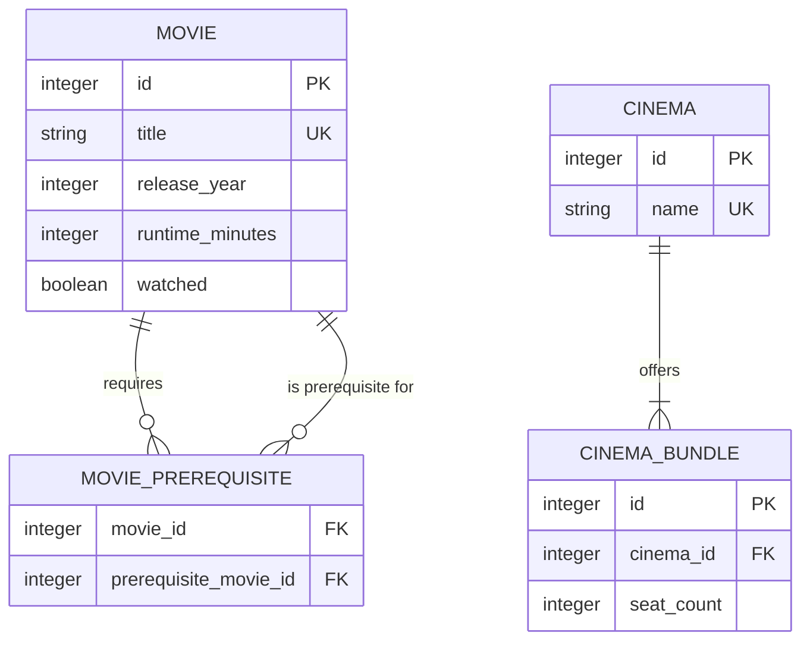

# Doomsday Ready

**Status:** In development

Doomsday Ready is a full-stack app for MCU fans preparing for _Avengers: Doomsday_. It helps users plan the movies they need to rewatch and calculate opening-night cinema seat bundles for a group.

This project is being developed as a full-stack internship assessment.

## Planned features

- Create and update movies, including prerequisites and watched status.
- Show the prerequisite movies for a selected target in a valid watch order, with watched progress and remaining runtime.
- Create cinemas with their available seat bundle sizes.
- Calculate the fewest bundles that exactly fit a group, or report when an exact booking is not possible.
- Provide a React interface for movies, rewatch plans, and booking quotes.

Movie prerequisite cycles must be rejected with HTTP `409` and error code `CIRCULAR_DEPENDENCY`.

## Technology

- Frontend: React and JavaScript
- Backend: Node.js, Express, and JavaScript
- Database: PostgreSQL

## Project structure

```text
apps/
  api/    Express API and database migrations
  web/    React frontend
```

## Data model



The diagram describes the intended data model and may be updated to match the final implementation.

## Getting started

Setup and run instructions will be added after the application structure and scripts are in place.

## AI use

I used ChatGPT to clarify the assessment requirements, discuss a project structure and work plan, and draft this starter README and `.gitignore`. I will update this section to describe any further AI assistance accurately. I will write and verify the rewatch-order, circular-dependency, and minimum-bundle logic myself, as required by the assessment.

## Assessment material

The assessment PDF is kept outside this repository. The project README records the requirements relevant to the implementation.
