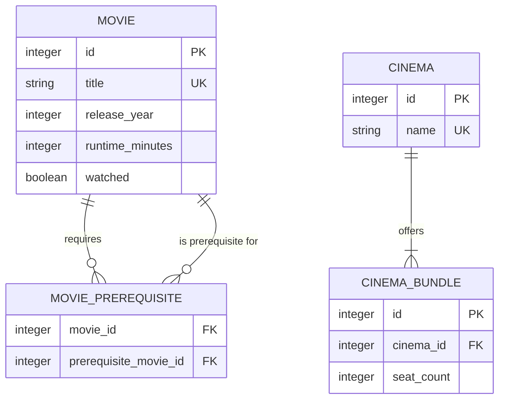

# Doomsday Ready

Doomsday Ready is a full-stack application for MCU fans preparing for *Avengers: Doomsday*. It helps users plan which movies they need to rewatch and calculate opening-night cinema seat bundles for a group.


## Features

- Create, list, and update movies, including prerequisites and watched status.
- Display prerequisite movies for a selected target in watch order, along with watched progress and remaining runtime.
- Create cinemas with their available seat bundle sizes through the API.
- Calculate the minimum number of bundles that exactly fit a group, or report when an exact booking is not possible.
- Use the React interface to manage movies, view rewatch plans, and request booking quotes.
- Reject circular movie prerequisites with HTTP `409 Conflict` and error code `CIRCULAR_DEPENDENCY`.

## Deployment

- **Frontend:** [Doomsday Ready Web](https://doomsday-ready-web.onrender.com/)
- **API base URL:** [Doomsday Ready API](https://doomsday-ready-api-nk4a.onrender.com/api)
- **API health check:** [Health Check](https://doomsday-ready-api-nk4a.onrender.com/api/health)

The deployed database starts with sample movie names. Add movies through the Movies screen. Cinemas can be created through the API.

## Technology Stack

- **Frontend:** React and JavaScript
- **Backend:** Node.js, Express, and JavaScript
- **Database:** PostgreSQL
- **Local development:** Docker Compose
- **Hosting:** Render

## Project Structure

```text
apps/
  api/
    migrations/
    src/
  web/
docker-compose.yml
README.md
```

## Data Model



## Getting Started

### Prerequisites

Make sure you have the following installed:

- [Docker Desktop](https://www.docker.com/products/docker-desktop/)
- [Node.js](https://nodejs.org/) and npm

### 1. Run the API and PostgreSQL with Docker

From the project root, run:

```powershell
docker compose up --build
```

This starts PostgreSQL and the API. The schema migration runs automatically when Docker initializes a new database volume.

The API is available at:

- **API:** http://localhost:3000
- **Health check:** http://localhost:3000/api/health

To stop the containers, press `Ctrl+C`.

To start the containers in the background, use:

```powershell
docker compose up -d
```

### 2. Run the Frontend

Open a second terminal and run:

```powershell
cd apps/web
npm install
npm run dev
```

Open the local URL printed by Vite, usually:

http://localhost:5173

### 3. Check the Frontend

From the `apps/web` directory, run:

```powershell
npm run lint
npm run build
```

## AI Usage

I used AI to discuss the project plan, draft documentation and database setup, develop frontend code, prepare the Docker Compose configuration, and troubleshoot deployment issues.

I reviewed and manually tested the application, including the assessment examples. AI also provided code suggestions for the rewatch-order and minimum-bundle features, which I reviewed and adapted as part of the implementation.
